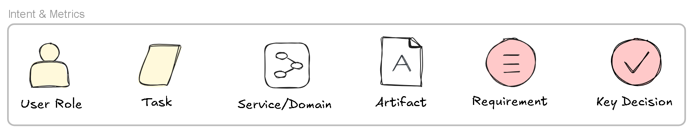
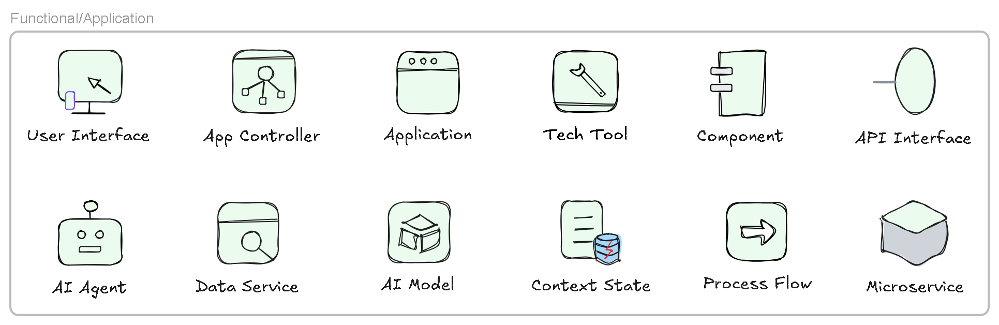
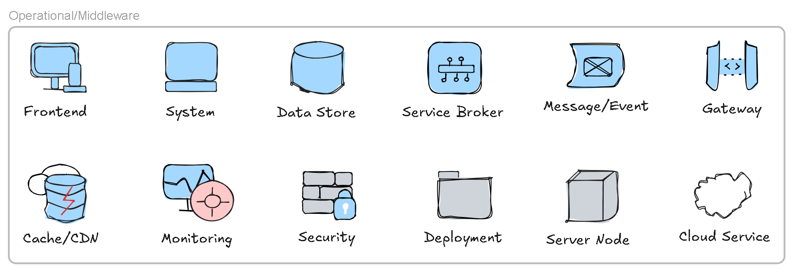

# Solution Architecture Elements

Solution architecture includes a high-level view of software engineering and systems engineering, together with requirements considerations. The elements are divided into three groups that provide coverage of the solution architecture. Instead of a long narrative, I list the solution elements in an easy-to-understand visual view.

> Solution architecture also involves solution architecture management (budget, resource, timeline, deliverable phase), which serves as a context for the solution architecture. This paper focuses on the content or the core of the solution architecture.

## Intent & Metric Elements

Figure 1 shows the intent and metrics layer elements. The yellowish color represents the user end, white represents business considerations and design decisions, and the light purple color represents the key metrics, including quality attributes, architectural decisions, and governance controls.

Figure 1. User Intent Elements

## Functional/Application Elements

Figure 2 shows a list of application-level elements. These are the critical functional service-level elements, each of which needs to be carefully considered. For AI solutions, AI-specific elements should also be included. The components are also related to software design and are either high-level or used for walkthroughs for validation purposes. The microservice elements are partially operational considerations.

Figure 2. Functional/Application Elements

## Operational/Middleware Elements

Figure 3 shows a list of operational/middleware elements. The bluish elements represent middleware, whereas the gray elements represent the operational infrastructure level.

Figure 3. Operational/Middleware Elements

## Key Architectural Concerns

With a well-defined set of solution architecture elements, we can facilitate architectural modeling by thinking through these elements to see how they are considered, mapped, and guided.
For a sound architecture, we need to look beyond technical details or specifications and focus on the architectural concerns that are significant to the solution. 

## Summary

Architectural modeling is not just about diagramming; it is a thinking process. Think through all the core solution elements, place them in your view to apply architectural techniques and identify their correlations. Through iteration and regular review, reach and maintain an architectural model that is holistic and rooted in simplicity and significance.
A solution covers both intent and architectural concerns, both software and system architectures, and both implicit enterprise input and explicit design guidance output. As part of **ESA** (enterprise solution architecture), it plays an increasingly important role in the AI era, when enterprise planning and solution design details are increasingly handled by AI.

## Reference Source

- [Fundamentals of Solution Architecture Modeling](https://seanguc.substack.com/p/fundamentals-of-solution-architecture)
- [Solution architecture element icons]([feat: new library Solution Architecture Elements by excalibot · Pull Request #2893 · excalidraw/excalidraw-libraries](https://github.com/excalidraw/excalidraw-libraries/pull/2893))
